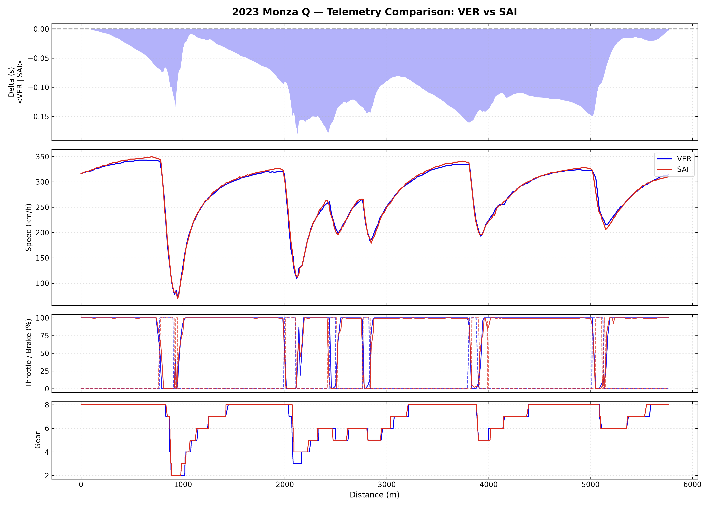

# F1 Telemetry & Delta-Time Analysis

A high-precision Motorsport Engineering tool designed to calculate continuous time deltas and compare multi-channel telemetry (Speed, Throttle, Brake, Gear) between drivers using `FastF1`, `Pandas`, `NumPy`, and `Matplotlib`.



## 🏎️ Key Features
- **Spatial Distance Alignment:** Resamples non-uniform temporal telemetry onto a unified $1\text{m}$ spatial grid ($d$) to enable accurate corner-by-corner overlay.
- **Continuous Time Delta:** Calculates continuous lap delta via numerical integration of spatial velocity steps:
  $$\Delta t(d) = \int \left( \frac{1}{v_{\text{comp}}(d)} - \frac{1}{v_{\text{ref}}(d)} \right) dd$$
- **Synchronized Multi-Panel Dashboard:** Stacked visualization sharing a unified X-axis for straightforward driver input correlation.

## 🛠️ Installation & Usage

1. **Clone Repository:**
   ```bash
   git clone [https://github.com/teotudora/f1-telemetry-delta.git](https://github.com/teotudora/f1-telemetry-delta.git)
   cd f1-telemetry-delta
